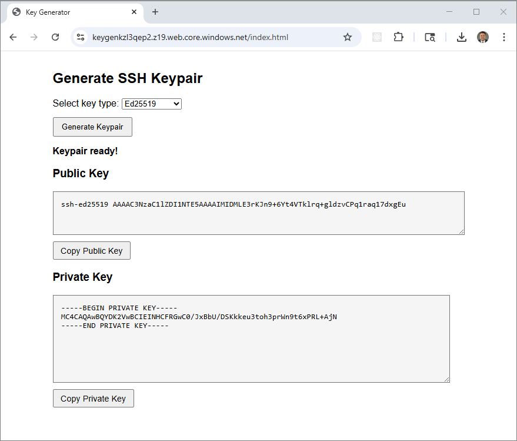

# SSH Key Generator on Azure: Functions, Service Bus and Cosmos DB

An asynchronous **SSH key pair generator** with a browser front end. A
client submits a request to an HTTP function in a **Flex Consumption
Function App**, which puts it on a **Service Bus** queue and returns an ID.
A queue-triggered function in the same app generates the key pair and stores
it in **Cosmos DB**, and the client polls a second endpoint until the result
is ready. A single-page web app, served from a **storage static website**,
does this from the browser.



| Piece | Where | Role |
|---|---|---|
| **func-keygen-&lt;suffix&gt;** | `sb-keygen-rg`, Central US | Function App on the `FC1` plan, Python 3.11, up to 50 instances of 2 GB; `keygen_post`, `keygen_get` (anonymous HTTP) and `keygen_worker` (Service Bus trigger); system-assigned managed identity; CORS allows any origin |
| **sb-keygen-&lt;suffix&gt;** | Service Bus, Standard | namespace with local (key) auth disabled; queue `keygen-requests`: 1 min lock, 10 delivery attempts, 10 min message TTL, dead-letters expired messages |
| **cosmos-keygen-&lt;suffix&gt;** | Cosmos DB, serverless | database `keygen`, container `results` partitioned on `/request_id`; each result expires after a day |
| **Role assignments** | managed identity | Service Bus Data Sender and Data Receiver on the queue; a custom Cosmos DB data role on the account |
| **sakeygen&lt;suffix&gt;** / **ai-keygen-&lt;suffix&gt;** | `sb-keygen-rg` | the deployment package storage, and Application Insights |
| **keygen&lt;suffix&gt;** | `sb-keygen-rg` | storage static website (`$web`) holding `index.html` and `favicon.ico` |

## Architecture

<picture>
  <source media="(prefers-color-scheme: dark)" srcset="architecture-dark.svg">
  
</picture>

Regenerate with `python3 make_diagram.py`.

- **`01-sb/`**: the resource group, Service Bus (`sb.tf`), Cosmos DB and its
  data role (`cosmos.tf`), and the Function App with its storage, plan and
  Application Insights (`functions.tf`).
- **`02-functions/`**: all three functions in `function_app.py`, with
  `host.json` and `requirements.txt`.
- **`03-webapp/`**: the static website storage account, and
  `index.html.tmpl`, which `apply.sh` fills in with the API URL.

No keys or connection strings are involved: the functions reach Service
Bus and Cosmos DB through `DefaultAzureCredential`, which resolves to the
app's managed identity.

## API

Routes are under the default `/api` prefix. There's no authentication.

| Method | Path | Body | Returns |
|---|---|---|---|
| POST | `/api/keygen` | `{"key_type": "rsa" \| "ed25519", "key_bits": 2048 \| 4096}`, both optional | `202` `{"request_id": "<uuid>", "status": "queued"}`; `500` if the send fails |
| GET | `/api/result/{request_id}` | none | `202` `{"status": "pending", "request_id": ...}` until the worker finishes, then `200` with the result |

The finished result is the Cosmos DB item:

```json
{
  "id": "630f70c4-815c-41d1-ae52-6babf3a41b1f",
  "request_id": "630f70c4-815c-41d1-ae52-6babf3a41b1f",
  "status": "complete",
  "key_type": "rsa",
  "key_bits": 2048,
  "public_key_b64": "c3NoLXJzYSBBQUFBQjNOemFDMXljMkVBQUFBREFRQUJBQUFCQVFD...",
  "private_key_b64": "LS0tLS1CRUdJTiBSU0EgUFJJVkFURSBLRVktLS0tLQpNSUlFb3dJQkFBS0NBUUVB...",
  "ttl": 86400,
  "expires_at": 1767225600
}
```

Both keys are base64-encoded. Decoded, the public key is in OpenSSH format
and the private key is an unencrypted PEM: traditional RSA format for RSA,
PKCS#8 for Ed25519. `key_bits` is ignored for Ed25519, and an unknown
`key_type` falls back to RSA. The item's `ttl` of 86400 seconds overrides
the container's one-hour default.

If the worker fails it re-raises, so Service Bus redelivers the message, up
to 10 times. A request still unprocessed after 10 minutes expires to the
dead-letter queue, and its result stays `pending`.

## Prerequisites

* [An Azure Account](https://portal.azure.com/)
* [Install AZ CLI](https://learn.microsoft.com/en-us/cli/azure/install-azure-cli)
* [Install Terraform](https://developer.hashicorp.com/terraform/install)
* [Install jq](https://jqlang.github.io/jq/download/), `zip` and `envsubst`

`check_env.sh` expects a service principal in `ARM_CLIENT_ID`,
`ARM_CLIENT_SECRET`, `ARM_SUBSCRIPTION_ID` and `ARM_TENANT_ID`. If this is
your first time following along, we recommend starting with this video:
[Azure + Terraform: Easy Setup](https://www.youtube.com/watch?v=j4aRjgH5H8Q).

## Deploy

```bash
git clone https://github.com/mamonaco1973/azure-sb-keygen.git
cd azure-sb-keygen
./apply.sh
```

`apply.sh` applies `01-sb`, zips `02-functions` and deploys it with
`az functionapp deployment source config-zip --build-remote true`, renders
`03-webapp/index.html` with the API URL using `envsubst`, and applies
`03-webapp`. It ends by running `validate.sh`, which submits an RSA 2048
request and polls every 2 seconds, up to 30 times, until it's complete (set
`KEY_TYPE` and `KEY_BITS` to try others):

```
NOTE: Submitted keygen request (630f70c4-815c-41d1-ae52-6babf3a41b1f).
NOTE: Polling for result...
NOTE: Attempt 1/30: pending...
NOTE: Key generation complete.

============================================================================
Azure Service Bus Quick Start - Validation Output
============================================================================

NOTE: Test Web URL:    https://keygen<suffix>.z19.web.core.windows.net/index.html
NOTE: API Base URI:    https://func-keygen-<suffix>.azurewebsites.net/api
```

## Try it

1. Open the **Test Web URL**, pick a key type and size, and generate a key
   pair; the page polls for the result and shows both keys.
2. Or call the API with `curl`:

   ```bash
   curl -s https://func-keygen-<suffix>.azurewebsites.net/api/result/<id> \
     | jq -r .private_key_b64 | base64 -d > id_rsa && chmod 600 id_rsa
   ```

## Teardown

```bash
./destroy.sh
```

## Notes

- **Lab only.** The functions are anonymous with CORS open to any origin,
  and generated private keys stay in Cosmos DB for a day. Anyone with a
  request ID can fetch its private key.
- `check_env.sh` doesn't check for `envsubst`, which `apply.sh` needs.
